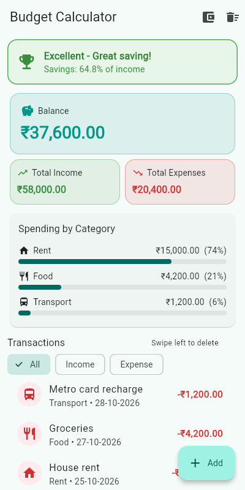
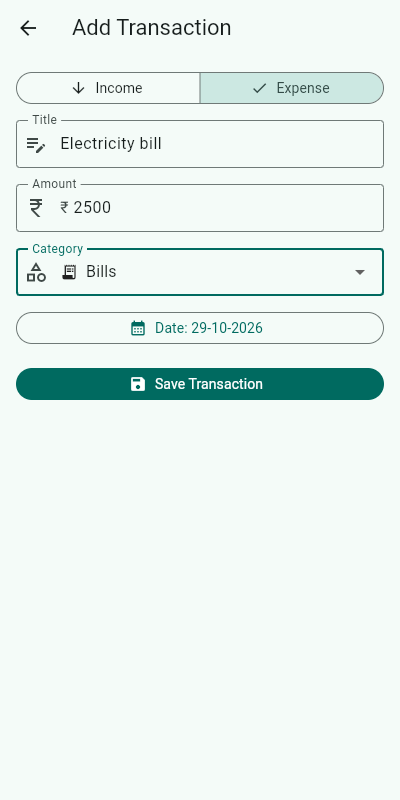
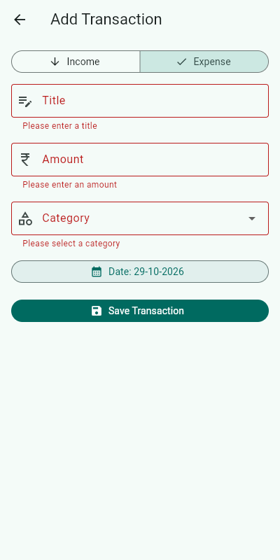
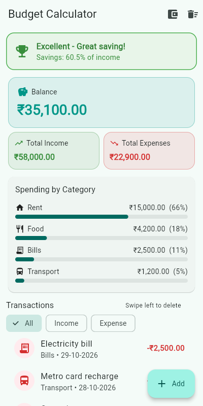
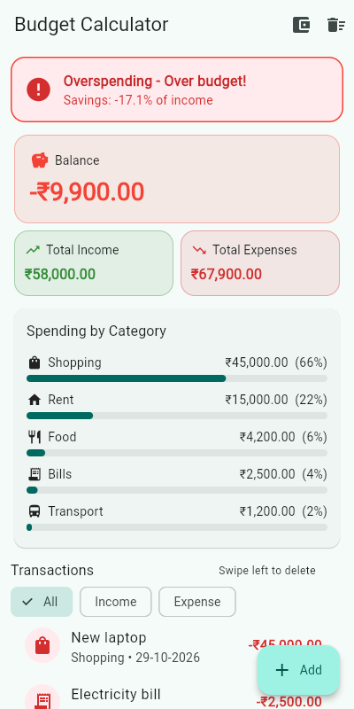

# Personal Budget Calculator (Experiment 5)

**24CS2016 - Building Applications using Flutter | URK23CS5014**

## Aim
To develop a Personal Budget Calculator that accepts user income and expenses, calculates the
remaining balance and displays the financial status using Flutter state management techniques.

## Features
- **App state with Provider:** a `ChangeNotifier` (`BudgetProvider`) supplied by
  `ChangeNotifierProvider` at the root. Widgets read it with `Consumer`, `context.watch`,
  `context.read` and `Selector`.
- **Local state with `setState`:** the All / Income / Expense filter tabs and the form fields.
- Dashboard with Total Income, Total Expenses and Balance cards in rupees (₹, 2 decimals).
- Financial status banner based on savings % (balance / total income x 100):
  Excellent (>= 30%), Good (10-29%), Warning (0-9%), Overspending (< 0) and "Add your income to begin".
- Spending breakdown by category with progress bars.
- Add Transaction form: income/expense toggle (`SegmentedButton`), category dropdown, date picker and
  validation.
- Swipe to delete with Undo, set the monthly income, and clear all data.
- Everything updates automatically when a transaction is added or deleted.

## Project structure
```
lib/
  main.dart
  models/transaction.dart
  providers/budget_provider.dart
  screens/home_screen.dart
  screens/add_transaction_screen.dart
  widgets/summary_card.dart
  widgets/status_banner.dart
  widgets/transaction_tile.dart
  widgets/category_breakdown.dart
  widgets/budget_input_field.dart
```

## How to run
```bash
flutter pub get
flutter run -d chrome
flutter test
```

## Screenshots
| Dashboard | Add transaction | Form validation | Updated balance | Overspending |
|---|---|---|---|---|
|  |  |  |  |  |
